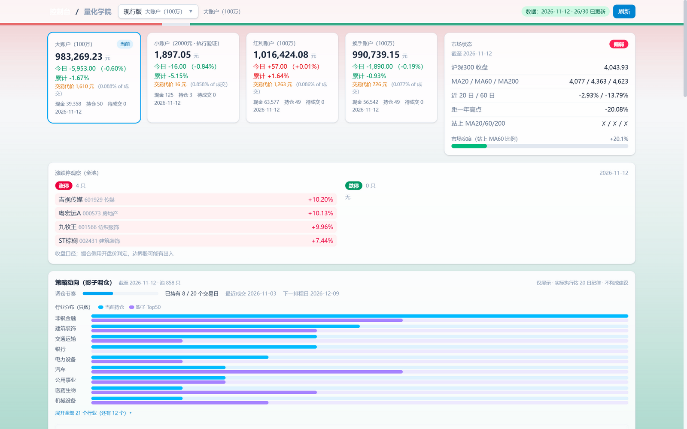
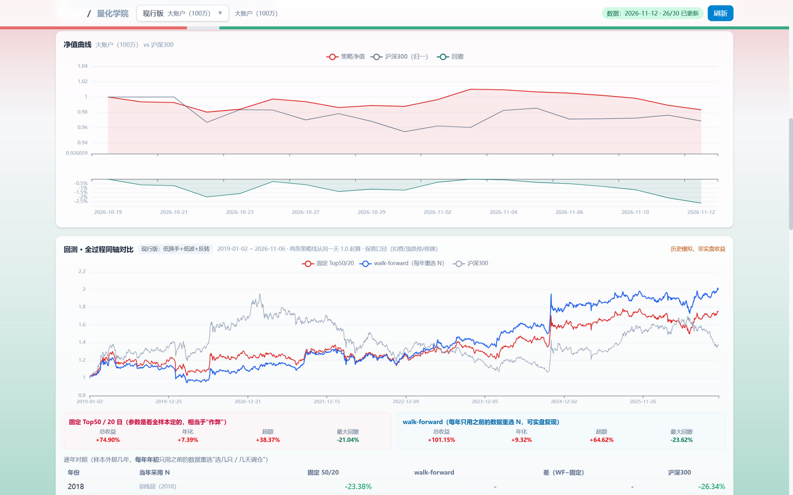
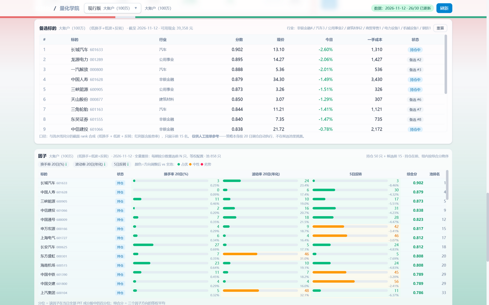
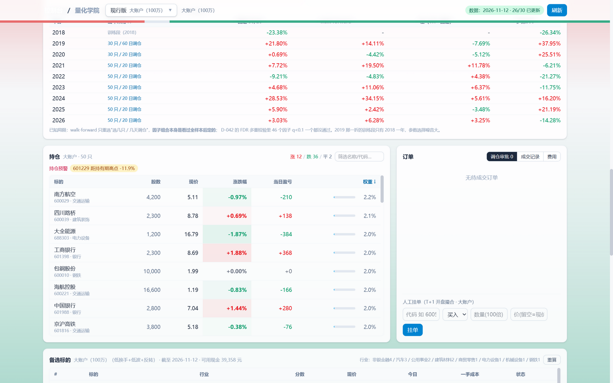
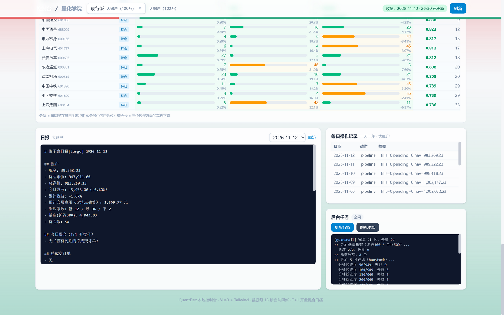
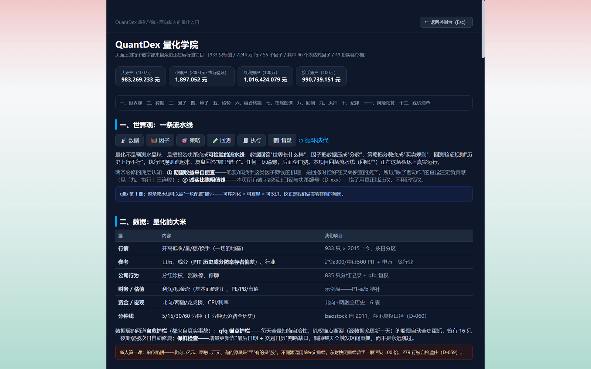

# QuantDex

> A 股个人量化系统：**多源数据仓库 → 因子研究 → 组合回测（walk-forward 防过拟合）→ 影子盘自动记账 → 每日邮件日报 + 本地控制台 → 实盘对接（QMT，规划中——从模拟到实践，见 docs/blog/第六篇）**。
> 从零构建、真实运行中——下面每个数字都来自本机正在跑的流水线。



## 它是什么

一套**个人自用**的 A 股量化研究与影子交易系统（Python + Vue3，Windows 本地运行）：

- **数据仓库**：东财 / 新浪 / baostock 多源抓取，Parquet 分区存储 + 增量更新 + 数据注册表；PIT 历史指数成分（消除幸存者偏差）、复权口径分文件隔离、退市股补齐
- **因子研究**：8 类量价因子 + RankIC / ICIR / Newey-West t / IC 衰减 / 五分组分层回测（算术 + 中位数双口径）
- **回测**：单标的向量化引擎 + 多标的组合回测（T+1 开盘成交、佣金 / 滑点 / 印花税 / 过户费 / 涨跌停停牌拒单）+ walk-forward 逐年重选参防过拟合
- **影子盘**：4 个模拟账户（100 万观察 / 2000 元执行验证 / 红利 / 换手）真实记账——快照、挂单、T+1 开盘撮合、日报，每日自动运行
- **自动化**：数据更新 → 流水线 → 合并日报邮件（QQ 邮箱）全自动；本地控制台（Vue3）可视化账户 / 持仓 / 待成交 / 备选池 / 日报



## 30 秒看第一张图（无需抓取任何数据）

仓库自带 ~0.24 MB demo 数据包（5 只大白马 × 2 年日线，真实行情切片）：

```bash
conda create -n QuantDex python=3.11 -y && conda activate QuantDex
pip install pandas numpy pyarrow pillow          # demo 只需这 4 个
python scripts/demo_quickstart.py                # 离线 ~2 秒：质检/概览/分年度/双均线回测 + 3 张图
```

图表输出到 `demo/store/plots/`（K 线均线 / 回测净值 / 分年度收益），全程不联网、不碰真实数据仓库。



## 完整搭建（真实数据，约 20–40 分钟）

```bash
conda create -n QuantDex python=3.11 -y && conda activate QuantDex
pip install -r requirements.txt -i https://pypi.tuna.tsinghua.edu.cn/simple

# 数据不在仓库里（D-035：git 只携带架构），按顺序自建（均可重复运行、自动增量）：
python scripts/00_fetch_pit_constituents.py   # PIT 历史指数成分（消除幸存者偏差的地基）
python scripts/00_fetch_calendar.py           # 交易日历
python scripts/01_init_universe.py            # 标的池 / 全量证券 / 行业
python scripts/02_update_market.py            # 核心标的日线（增量）
python scripts/03_fetch_alternative.py        # 估值 / 财务 / 资金流 / 宏观

# 单标的演示
python scripts/demo_analysis.py 600519
```

**本地控制台**：`python scripts/16_webapp.py` → 浏览器打开 <http://127.0.0.1:8765>（首次启动自动生成登录凭证，见 `data/store/webauth.json`）。
**每日自动化**：右键运行 `scripts/13_setup_task.ps1` 安装 Windows 任务计划（每天 19:00，错过自动补跑）。



## 测试

```bash
python tests/run_tests.py      # 零依赖回归测试（引擎成本/T+1 口径、组合权重、风控、账本幂等）
```



## 文档索引

| 文档 | 内容 |
|---|---|
| [docs/DEV_README.md](docs/DEV_README.md) | **开发者参考**：目录结构、数据 Schema、API 速查、因子研究方法论与实测结论、已知边界 |
| [docs/PROJECT_GUIDE.md](docs/PROJECT_GUIDE.md) | **所有者手册**（门外汉视角）：概念小词典、每日操作 SOP、故障排查 |
| [docs/DECISIONS.md](docs/DECISIONS.md) | 决策日志 D-001 ~ D-094：每个口径为什么这么定（D-085/086/087/090 有重号修正史，见 DECISIONS.md 头部批注） |
| [scripts/README.md](scripts/README.md) | 按编号的一键脚本运行顺序表 |
| [docs/DATA_ROADMAP.md](docs/DATA_ROADMAP.md) | 数据现状盘点与补数计划 |



## 许可证与免责声明

本项目以 [MIT 协议](LICENSE) 开源。

仅供学习与研究使用，不构成任何投资建议。作者不对使用本工具产生的任何盈亏负责。
仓库中的 demo 数据包为真实行情切片，仅作演示用途。
